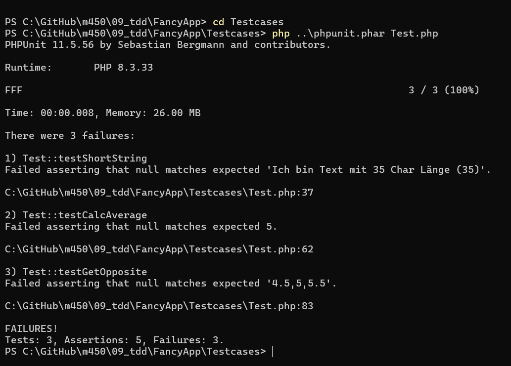
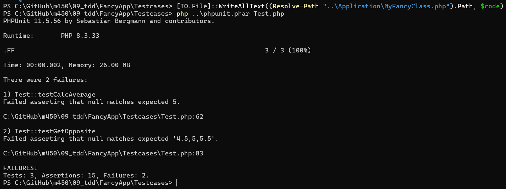
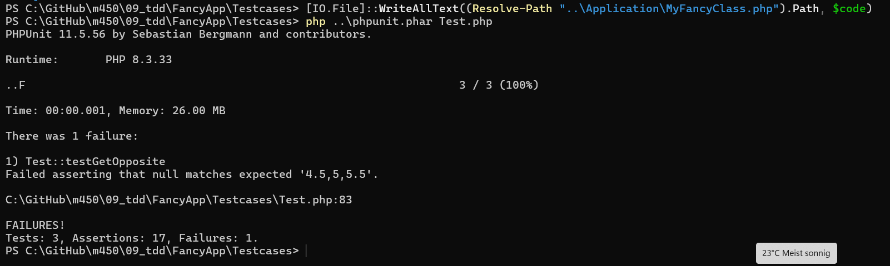
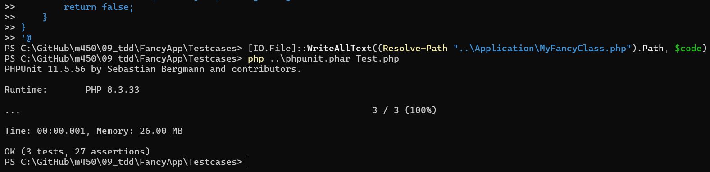
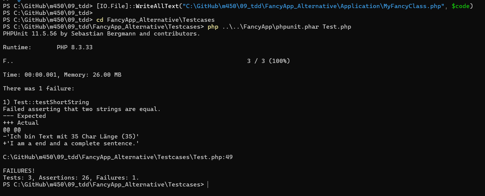
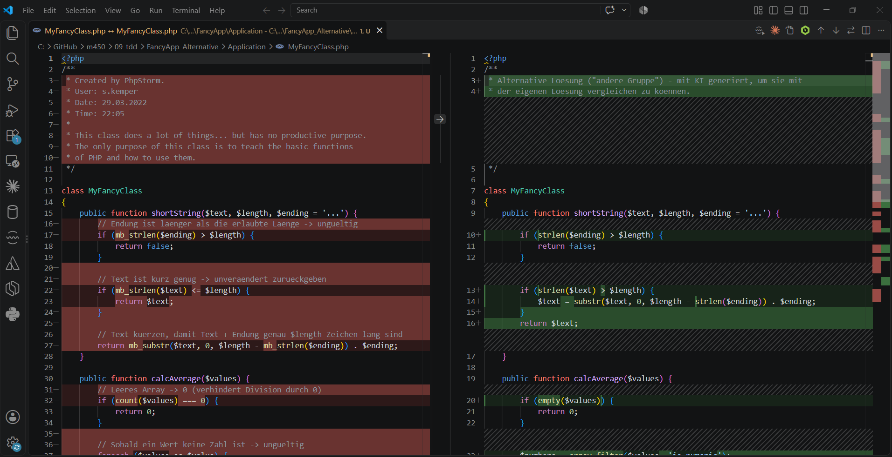
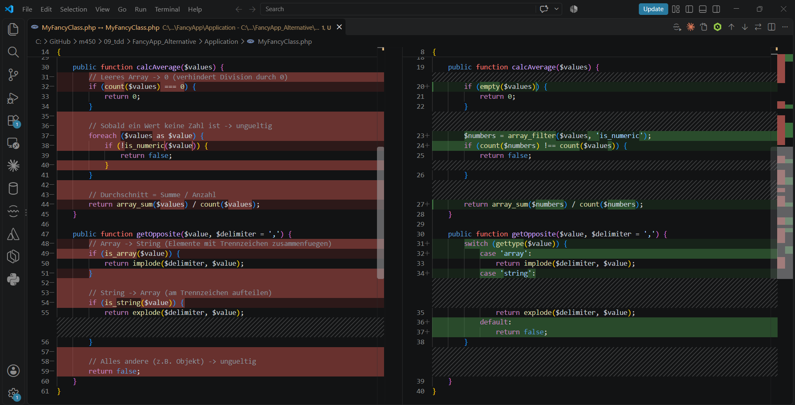

# Block 9 – Test Driven Development (TDD)

## Theorie

**Test Driven Development (TDD)** bedeutet, dass man **zuerst die Tests schreibt** und erst danach den Code. Die Tests beschreiben also die Anforderungen an die Applikation. Der Code wird dann so lange geschrieben, bis alle Tests bestehen.

TDD läuft immer im gleichen Zyklus ab: **Red – Green – Refactor**

| Phase | Was passiert |
|---|---|
| 🔴 **Red** | Es gibt einen Test, aber noch keinen (passenden) Code. Der Test schlägt fehl. |
| 🟢 **Green** | Man schreibt so viel Code, dass der Test besteht – nicht mehr. |
| 🔵 **Refactor** | Wenn alle Tests grün sind, kann man den Code aufräumen und verbessern. Die Tests stellen sicher, dass dabei nichts kaputtgeht. |

Das Ganze ist ein **iterativer Prozess**: Man wiederholt den Zyklus für jede Funktion, bis alles umgesetzt ist.

**Vorteile von TDD:**
- Man weiss jederzeit, ob der Code funktioniert
- Weniger Bugs, weil jede Anforderung einen Test hat
- Refactoring ist ohne Angst möglich
- Der Code wird automatisch modularer und besser testbar

In diesem Block waren die Tests (`Test.php`) schon vorgegeben. Die Klasse `MyFancyClass` hatte aber nur leere Methoden. Meine Aufgabe war es, die Methoden so zu implementieren, dass alle Tests grün werden.

---

## Aufgabe 1 – Setup Environment

Auf meinem Laptop war weder PHP noch PHPUnit installiert. So habe ich alles eingerichtet:

**1. PHP installieren** (über den Windows-Paketmanager winget):

```powershell
winget install PHP.PHP.8.3
```

**2. `php.ini` erstellen:** Ich habe die mitgelieferte `php.ini-development` kopiert und darin die Erweiterungen `mbstring` und `openssl` aktiviert. `mbstring` braucht PHPUnit und auch meine Lösung (für Umlaute, siehe Aufgabe 2). Zusätzlich habe ich die Umgebungsvariable `PHPRC` gesetzt, damit PHP die `php.ini` immer findet.

**3. PHPUnit herunterladen:** Statt Composer habe ich PHPUnit direkt als einzelne Datei (`phpunit.phar`) in den Projektordner geladen:

```powershell
Invoke-WebRequest -Uri "https://phar.phpunit.de/phpunit-11.phar" -OutFile "phpunit.phar"
php phpunit.phar --version
# PHPUnit 11.5.56 by Sebastian Bergmann and contributors.
```

Die `phpunit.phar` ist in der `.gitignore`, weil sie ein Tool ist und nicht zum Projekt gehört.

**4. `Test.php` auf neues PHPUnit anpassen:** Die Testdatei war noch für ein altes PHPUnit geschrieben (`PHPUnit_Framework_TestCase`). Im File selbst stand schon als Kommentar, was man bei neuerem PHPUnit ändern muss. Ich habe nur diese zwei Zeilen angepasst – die Tests selbst habe ich **nicht** verändert:

```php
use PHPUnit\Framework\TestCase;

class Test extends TestCase
```

**Tests ausführen:** Die Tests müssen aus dem Ordner `Testcases` gestartet werden, weil `Test.php` die Klasse mit einem relativen Pfad (`../Application/MyFancyClass.php`) einbindet:

```powershell
cd FancyApp\Testcases
php ..\phpunit.phar Test.php
```

---

## Aufgabe 2 – Methoden implementieren

Ich bin genau nach dem TDD-Zyklus vorgegangen: zuerst alle Tests rot laufen lassen, dann **eine Methode nach der anderen** implementieren und nach jeder Methode die Tests neu starten.

### 🔴 Red – Ausgangslage

Ohne Code in den Methoden schlagen alle 3 Tests fehl, weil jede Methode nur `null` zurückgibt.



### 🟢 Green – Methode 1: `shortString()`

Die Methode soll einen Text auf eine maximale Länge kürzen und eine Endung (Standard `...`) anhängen.

**Anforderungen aus den Tests:**

| Anforderung | Beispiel |
|---|---|
| Endung länger als `$length` → `false` | Länge 20, Endung mit 35 Zeichen → `false` |
| Text kurz genug → unverändert zurück | 35-Zeichen-Text bei Länge 100 → gleicher Text |
| Text zu lang → kürzen, Endung zählt zur Länge dazu | Länge 100 → 97 Zeichen + `...` |
| Leere Endung ist erlaubt | Länge 129, Endung `''` → endet mit `a` |
| Umlaute zählen als **ein** Zeichen | `'... Länge (35)'` muss 35 Zeichen lang sein |

Wichtig war der letzte Punkt: Der Testtext `'Ich bin Text mit 35 Char Länge (35)'` hat 35 Zeichen, aber 36 Bytes, weil das "ä" in UTF-8 zwei Bytes braucht. Das normale `strlen()` zählt Bytes, darum habe ich `mb_strlen()` und `mb_substr()` verwendet, die echte Zeichen zählen.

```php
public function shortString($text, $length, $ending = '...') {
    // Endung ist laenger als die erlaubte Laenge -> ungueltig
    if (mb_strlen($ending) > $length) {
        return false;
    }

    // Text ist kurz genug -> unveraendert zurueckgeben
    if (mb_strlen($text) <= $length) {
        return $text;
    }

    // Text kuerzen, damit Text + Endung genau $length Zeichen lang sind
    return mb_substr($text, 0, $length - mb_strlen($ending)) . $ending;
}
```

Ergebnis: `testShortString` ist grün, die anderen zwei sind noch rot.



### 🟢 Green – Methode 2: `calcAverage()`

Die Methode soll den Durchschnitt von mehreren Werten berechnen.

**Anforderungen aus den Tests:**

| Anforderung | Beispiel |
|---|---|
| Leeres Array → `0` | `[]` → `0` |
| Durchschnitt berechnen | `[4.5, 5.0, 5.5]` → `5` |
| Zahlen als Strings funktionieren auch | `['4.5', '5.0', '5.5']` → `5` |
| Ein Wert ist keine Zahl → `false` | `['3.44', 'bestanden', 'nicht bewertbar']` → `false` |

Das leere Array prüfe ich zuerst, damit keine Division durch 0 passiert. Mit `is_numeric()` prüfe ich jeden Wert – diese Funktion akzeptiert auch Strings wie `'4.5'`.

```php
public function calcAverage($values) {
    // Leeres Array -> 0 (verhindert Division durch 0)
    if (count($values) === 0) {
        return 0;
    }

    // Sobald ein Wert keine Zahl ist -> ungueltig
    foreach ($values as $value) {
        if (!is_numeric($value)) {
            return false;
        }
    }

    // Durchschnitt = Summe / Anzahl
    return array_sum($values) / count($values);
}
```

Ergebnis: 2 von 3 Tests sind grün.



### 🟢 Green – Methode 3: `getOpposite()`

Wie der Name sagt, macht die Methode aus einem Wert das **Gegenteil**: aus einem Array einen String und aus einem String ein Array.

**Anforderungen aus den Tests:**

| Anforderung | Beispiel |
|---|---|
| Array → String (mit Trennzeichen zusammengefügt) | `[4.5, 5.0, 5.5]` → `'4.5,5,5.5'` |
| String → Array (am Trennzeichen aufgeteilt) | `'Apfel,Birne'` → `['Apfel', 'Birne']` |
| Standard-Trennzeichen ist `,` | `getOpposite($x)` = `getOpposite($x, ',')` |
| Hin und zurück ergibt das Original | `getOpposite(getOpposite($s)) == $s` |
| Weder Array noch String → `false` | Objekt → `false` |

Dafür gibt es in PHP die Funktionen `implode()` (Array → String) und `explode()` (String → Array). Interessant: Der Float `5.0` wird beim Zusammenfügen zu `"5"`, der String `'5.0'` bleibt aber `"5.0"`. Darum erwartet der Test einmal `'4.5,5,5.5'` und einmal `'4.5,5.0,5.5'`.

```php
public function getOpposite($value, $delimiter = ',') {
    // Array -> String (Elemente mit Trennzeichen zusammenfuegen)
    if (is_array($value)) {
        return implode($delimiter, $value);
    }

    // String -> Array (am Trennzeichen aufteilen)
    if (is_string($value)) {
        return explode($delimiter, $value);
    }

    // Alles andere (z.B. Objekt) -> ungueltig
    return false;
}
```

Ergebnis: **Alle 3 Tests mit 27 Assertions sind grün.**



### 🔵 Refactor

Nachdem alle Tests grün waren, habe ich den Code nochmals angeschaut. Jede Methode ist kurz, macht nur eine Sache und ist kommentiert. Ich habe deshalb nichts mehr umgebaut. Falls ich später etwas ändere, zeigen mir die Tests sofort, ob noch alles funktioniert.

---

## Aufgabe 3 – Auswerten

Da ich das Modul alleine bearbeite, hatte ich keine andere Gruppe zum Vergleichen. Ich habe deshalb von einer **KI eine alternative Lösung generieren lassen**, die so aussieht, wie eine andere Gruppe die Aufgabe lösen könnte. Diese liegt im Ordner `FancyApp_Alternative` und wird mit **den gleichen Tests** geprüft.

### Testergebnis der Alternative

Bei der Alternative schlägt `testShortString` fehl (Zeile 49 in `Test.php`), die anderen zwei Tests sind grün.



### Vergleich mit Text-Compare-Tool

Als Text-Compare-Tool habe ich den Diff-Viewer von VS Code verwendet:

```powershell
code --diff FancyApp\Application\MyFancyClass.php FancyApp_Alternative\Application\MyFancyClass.php
```

Links ist meine Lösung, rechts die Alternative.





### Unterschiede

| Methode | Meine Lösung | Alternative | Gleiche Funktion? |
|---|---|---|---|
| `shortString` | `mb_strlen` / `mb_substr` | `strlen` / `substr` | ❌ **Nein** – Fehler bei Umlauten |
| `calcAverage` | `foreach` mit `is_numeric` | `array_filter` mit `is_numeric` | ✅ Ja |
| `getOpposite` | `if` mit `is_array` / `is_string` | `switch` mit `gettype()` | ✅ Ja |

**Haben wir die Anwendung gleich implementiert?**
Nein. Der Code sieht bei allen drei Methoden unterschiedlich aus.

**Tun die Anwendungen dasselbe?**
Bei `calcAverage` und `getOpposite` ja – der Code ist anders geschrieben, aber das Verhalten ist gleich. Das zeigen die grünen Tests.

Bei `shortString` gibt es eine **Abweichung in der Funktionalität**: `strlen` zählt Bytes statt Zeichen. Der Text `'Ich bin Text mit 35 Char Länge (35)'` gilt dadurch als 36 Zeichen lang, also als zu lang. Die Alternative kürzt ihn darum auf 0 Zeichen und gibt nur noch die Endung zurück:

```
- 'Ich bin Text mit 35 Char Länge (35)'   (erwartet)
+ 'I am a end and a complete sentence.'    (tatsächlich)
```

**Ist die Abweichung gross oder vernachlässigbar?**
Die Abweichung ist klein im Code (nur `strlen` statt `mb_strlen`), aber **nicht vernachlässigbar**: Bei jedem Text mit Umlauten (ä, ö, ü) wird falsch gekürzt – und im Deutschen kommen Umlaute ständig vor. Ohne den Test wäre dieser Fehler wahrscheinlich niemandem aufgefallen.

---

## Fazit

Mit TDD beschreiben die Tests genau, was die Applikation tun muss. Ich musste nur die Tests lesen und verstehen, dann war klar, was die Methoden machen sollen – eine zusätzliche Beschreibung brauchte es nicht.

Der Vergleich in Aufgabe 3 zeigt den grössten Vorteil von TDD: Zwei Lösungen können sehr unterschiedlich aussehen und trotzdem beide korrekt sein. Die Tests entscheiden objektiv, ob eine Lösung die Anforderungen erfüllt. Ein kleiner Fehler wie `strlen` statt `mb_strlen` wird sofort erkannt.
