# Tuning-Werkstatt Auftragsservice

M450 Abschlussprojekt – Ramadan Asani, AP24b, TBZ Zürich

Ein kleiner REST-Service für eine Tuning-Werkstatt: Werkstattaufträge werden erfasst, die Verfügbarkeit der benötigten Teile wird bei einem externen Lieferanten geprüft und der Preis inklusive Rabatten automatisch berechnet.

Der Fokus des Projekts liegt bewusst **nicht auf möglichst viel Funktionalität**, sondern auf einer sauberen und vollständigen **Teststrategie**: Unit Tests, Integration Tests, Mocking, TDD, Testreports, Code Coverage und eine CI/CD-Pipeline.

**Veröffentlichte Testreports (GitHub Pages):** https://ramadan54.github.io/m450/

| Report | Link |
|---|---|
| Testresultate (Surefire) | https://ramadan54.github.io/m450/tests/surefire.html |
| Code Coverage (JaCoCo) | https://ramadan54.github.io/m450/coverage/index.html |
| Pipeline-Läufe | https://github.com/Ramadan54/m450/actions |

---

## Inhaltsverzeichnis

1. [Funktionalität](#1-funktionalität)
2. [Technologien](#2-technologien)
3. [Planung](#3-planung)
4. [Architektur](#4-architektur)
5. [Teststrategie](#5-teststrategie)
6. [Testkonzept](#6-testkonzept)
7. [Test Driven Development](#7-test-driven-development)
8. [Mocking](#8-mocking)
9. [Testreports und Code Coverage](#9-testreports-und-code-coverage)
10. [CI/CD-Pipeline](#10-cicd-pipeline)
11. [Projekt lokal ausführen](#11-projekt-lokal-ausführen)
12. [KI-Nutzung im Projekt](#12-ki-nutzung-im-projekt)
13. [Reflexion über TDD und Code Reviews](#13-reflexion-über-tdd-und-code-reviews)
14. [Fazit](#14-fazit)

---

## 1. Funktionalität

| Endpoint | Beschreibung | Antwort |
|---|---|---|
| `POST /auftraege` | Neuen Auftrag erstellen | `201 Created`, `400 Bad Request` bei ungültigen Daten, `409 Conflict` wenn das Teil nicht verfügbar ist |
| `GET /auftraege/{id}` | Auftrag abrufen | `200 OK`, `404 Not Found` wenn die ID nicht existiert |

**Geschäftsregeln der Preisberechnung (`PreisRechner`):**

| # | Regel |
|---|---|
| 1 | Preis = Arbeitsstunden × 120 CHF + Teilekosten |
| 2 | Ab einer Zwischensumme von 1000 CHF gibt es 5 % Mengenrabatt |
| 3 | Stammkunden erhalten 10 % Rabatt, kombinierbar mit dem Mengenrabatt (total 15 %) |
| 4 | Negative Arbeitsstunden oder Teilekosten sind ungültig |
| 5 | Der Preis wird kaufmännisch auf Rappen gerundet |

**Beispiel-Request:**

```json
{
  "kundenname": "Max Muster",
  "fahrzeug": "VW Golf GTI",
  "teilenummer": "TURBO-001",
  "arbeitsstunden": 10,
  "teilekosten": 300,
  "stammkunde": true
}
```

Ergebnis: 10 h × 120 CHF + 300 CHF = 1500 CHF, abzüglich 15 % Rabatt = **1275.00 CHF**

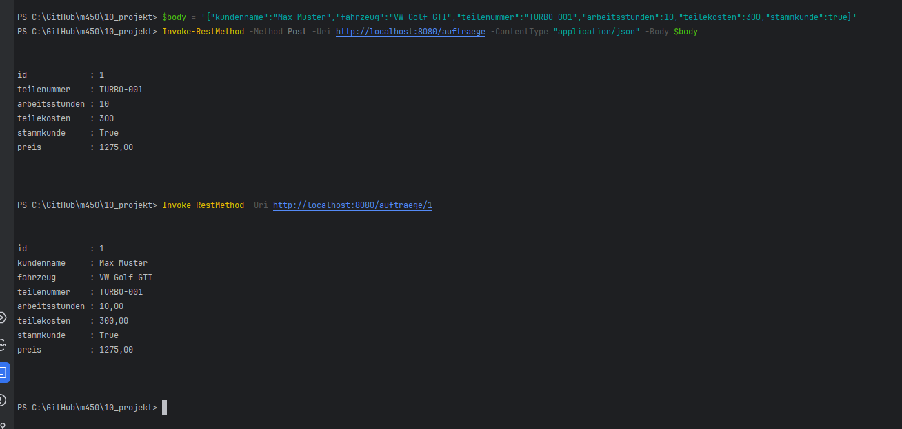

---

## 2. Technologien

| Bereich | Technologie |
|---|---|
| Sprache / Framework | Java 17, Spring Boot 3.5 |
| Build | Maven (Maven Wrapper `mvnw`) |
| Datenbank | H2 In-Memory |
| Test-Framework | JUnit 5 |
| Assertions | AssertJ |
| Mocking | Mockito (`@Mock`, `@MockitoBean`) |
| Integration Tests | Spring Boot Test, MockMvc |
| Testreport | Maven Surefire Report Plugin |
| Code Coverage | JaCoCo |
| CI/CD | GitHub Actions, GitHub Pages |

---

## 3. Planung

Das Projekt wurde bewusst klein gehalten (Rahmen 8–12 h) und auf fünf Arbeitstage verteilt. Nach jedem Teilschritt wurde committet und gepusht, damit der Arbeitsprozess im Git-Verlauf nachvollziehbar ist.

| Tag | Datum | Inhalt | Aufwand |
|---|---|---|---|
| 1 | 21.10.2026 | Projekt-Setup (Spring Boot, Maven Wrapper), TDD-Zyklus 1 (Grundpreis) und 2 (Mengenrabatt) | ca. 3 h |
| 2 | 23.10.2026 | TDD-Zyklus 3 (Stammkundenrabatt inkl. Refactor) und 4 (Validierung), Entity und Repository | ca. 1.5 h |
| 3 | 26.10.2026 | Externe Schnittstelle, Service mit Mockito-Unit-Tests, Controller, Integration Tests | ca. 2 h |
| 4 | 28.10.2026 | JaCoCo und Surefire-Report, Coverage-Lücke geschlossen, CI/CD-Pipeline mit GitHub Pages, Dokumentation | ca. 2.5 h |
| 5 | 30.10.2026 | Video aufnehmen und schneiden | ca. 1.5 h |
| | | **Total** | **ca. 10.5 h** |

**Scope-Entscheid:** Statt vieler Endpoints (Update, Delete, Listen, Filter) gibt es nur zwei. Dafür ist jede Schicht der Anwendung mit der passenden Testart abgedeckt.

---

## 4. Architektur

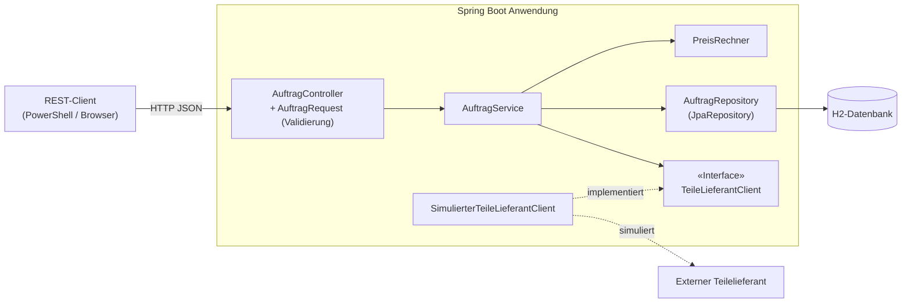

| Schicht | Klasse | Aufgabe |
|---|---|---|
| Controller | `AuftragController`, `AuftragRequest` | REST-Endpoints, Eingabevalidierung (`@Valid`) |
| Service | `AuftragService` | Ablauf: Teil prüfen → Preis berechnen → speichern |
| Service | `PreisRechner` | Reine Preis- und Rabattlogik (mit TDD entwickelt) |
| Service | `TeilNichtVerfuegbarException`, `AuftragNichtGefundenException` | Fehlerfälle, gemappt auf HTTP 409 und 404 |
| Repository | `AuftragRepository` | Datenbankzugriff über Spring Data JPA |
| Client | `TeileLieferantClient`, `SimulierterTeileLieferantClient` | Schnittstelle zum externen Lieferanten (simuliert) |
| Model | `Auftrag` | JPA-Entity |

Alle Abhängigkeiten werden über **Constructor Injection** übergeben. Dadurch können sie in Tests einfach durch Mocks ersetzt werden.

---

## 5. Teststrategie

### Grundsatz

Getestet wird nach der **Testpyramide**: viele schnelle, isolierte Unit Tests für die Logik, wenige, aber umfassendere Integration Tests für das Zusammenspiel der Schichten. Externe Systeme, die nicht kontrollierbar sind, werden gemockt.

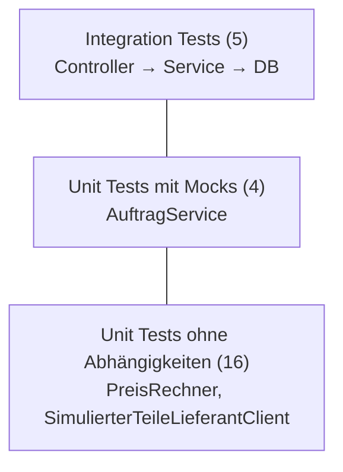

### Testarten und Werkzeuge

| Testart | Testobjekt | Werkzeuge | Spring | Datenbank | Lieferant |
|---|---|---|---|---|---|
| Unit Test | `PreisRechner` | JUnit 5, AssertJ | nein | nein | – |
| Unit Test | `SimulierterTeileLieferantClient` | JUnit 5, `@ParameterizedTest` | nein | nein | echt |
| Unit Test mit Mocks | `AuftragService` | JUnit 5, Mockito `@Mock` | nein | gemockt | gemockt |
| Integration Test | `AuftragController` (ganzer Ablauf) | `@SpringBootTest`, MockMvc, `@MockitoBean` | ja | echte H2 | gemockt |
| Smoke Test | Spring-Kontext | `@SpringBootTest` | ja | echte H2 | echt |

### Angewandte Testtechniken

- **Grenzwertanalyse:** Mengenrabatt mit 999.99 CHF (knapp darunter), 1000.00 CHF (genau auf der Grenze) und 1500.00 CHF (darüber)
- **Äquivalenzklassen:** Stammkunde / kein Stammkunde, Teil verfügbar / nicht verfügbar, gültige / ungültige Eingaben
- **Negativtests:** Negative Werte, leere Felder, unbekannte IDs, unbekannte Teilenummern
- **Parametrisierte Tests:** Ein Test läuft automatisch mit mehreren Eingabewerten

### Bewusste Entscheidungen

- Der `PreisRechner` wird in den Service-Tests **nicht** gemockt. Er ist reine Logik ohne Aussenwelt und bereits vollständig getestet.
- Der externe Lieferant wird auch im Integration Test gemockt, weil eine echte Fremd-API in Tests langsam und unzuverlässig wäre und ihr Verhalten nicht steuerbar ist.
- Getter und Setter der Entity `Auftrag` werden nicht separat getestet, da sie keine Logik enthalten. Das erklärt die 70 % Coverage im Paket `model`.
- Jeder Integration Test startet mit leerer Datenbank (`deleteAll()` in `@BeforeEach`), damit die Tests unabhängig voneinander und in beliebiger Reihenfolge laufen.

---

## 6. Testkonzept

### Testobjekte und Ziele

| Testobjekt | Testziel |
|---|---|
| `PreisRechner` | Korrekte Preisberechnung inkl. aller Rabattkombinationen, Rundung und Validierung |
| `AuftragService` | Korrekter Ablauf: Verfügbarkeit prüfen, Preis setzen, speichern bzw. bei Fehlern nicht speichern |
| `AuftragController` | Korrekte HTTP-Statuscodes, JSON-Antworten und Persistenz über alle Schichten |
| `SimulierterTeileLieferantClient` | Korrekte Antwort für bekannte und unbekannte Teilenummern |

### Testumgebung

- Lokal: Windows, Java 17, Maven Wrapper, IntelliJ IDEA
- Pipeline: GitHub Actions, `ubuntu-latest`, Temurin JDK 17
- Datenbank: H2 In-Memory (wird bei jedem Testlauf neu erstellt)

### Testfälle

| ID | Testklasse | Testfall | Erwartetes Ergebnis |
|---|---|---|---|
| T01 | PreisRechnerTest | 2 h + 150 CHF Teile, kein Stammkunde | 390.00 CHF |
| T02 | PreisRechnerTest | 3 h, keine Teile | 360.00 CHF |
| T03 | PreisRechnerTest | Zwischensumme 999.99 CHF | 999.99 CHF, kein Rabatt |
| T04 | PreisRechnerTest | Zwischensumme genau 1000 CHF | 950.00 CHF (−5 %) |
| T05 | PreisRechnerTest | Zwischensumme 1500 CHF | 1425.00 CHF (−5 %) |
| T06 | PreisRechnerTest | Stammkunde, 390 CHF | 351.00 CHF (−10 %) |
| T07 | PreisRechnerTest | Stammkunde, 1500 CHF | 1275.00 CHF (−15 %) |
| T08 | PreisRechnerTest | Negative Arbeitsstunden | `IllegalArgumentException` |
| T09 | PreisRechnerTest | Negative Teilekosten | `IllegalArgumentException` |
| T10 | AuftragServiceTest | Teil verfügbar | Preis gesetzt, Auftrag gespeichert |
| T11 | AuftragServiceTest | Teil nicht verfügbar | `TeilNichtVerfuegbarException`, nichts gespeichert |
| T12 | AuftragServiceTest | Auftrag vorhanden | Auftrag wird zurückgegeben |
| T13 | AuftragServiceTest | Auftrag nicht vorhanden | `AuftragNichtGefundenException` |
| T14 | AuftragControllerIntegrationTest | POST mit gültigen Daten | 201, Preis 1275.00, 1 Eintrag in DB |
| T15 | AuftragControllerIntegrationTest | POST, Teil nicht verfügbar | 409, kein Eintrag in DB |
| T16 | AuftragControllerIntegrationTest | POST mit ungültigen Daten | 400, Lieferant wird nicht aufgerufen |
| T17 | AuftragControllerIntegrationTest | GET mit vorhandener ID | 200 mit Auftragsdaten |
| T18 | AuftragControllerIntegrationTest | GET mit unbekannter ID | 404 |
| T19 | SimulierterTeileLieferantClientTest | 4 bekannte Teilenummern (parametrisiert) | `true` |
| T20 | SimulierterTeileLieferantClientTest | Unbekannt, leer, Kleinschreibung (parametrisiert) | `false` |
| T21 | WerkstattApplicationTests | Spring-Kontext starten | Startet ohne Fehler |

Durch die parametrisierten Tests ergeben sich daraus insgesamt **26 ausgeführte Tests**.

### Ein- und Ausstiegskriterien

- **Einstieg:** Das Projekt kompiliert (`Build`-Stage der Pipeline erfolgreich).
- **Ausstieg:** Alle Tests sind grün, die Geschäftslogik (`service`) hat 100 % Line- und Branch-Coverage. Erst dann werden die Reports veröffentlicht (`Deploy`-Stage).

---

## 7. Test Driven Development

Der `PreisRechner` wurde vollständig mit TDD entwickelt. Jede Phase ist ein eigener Commit, sodass im Git-Verlauf sichtbar ist, dass der Test immer **vor** dem Code existierte.

| Zyklus | Anforderung | 🔴 Red | 🟢 Green | 🔵 Refactor |
|---|---|---|---|---|
| 1 | Grundpreis | Tests für Stunden × Satz + Teile | Berechnung umgesetzt | – |
| 2 | Mengenrabatt ab 1000 CHF | Grenzwert-Tests | `if` mit `>= 1000` | – |
| 3 | Stammkundenrabatt | Tests für 10 % und Kombination | Rabattsätze addieren | Hilfsmethoden, Rundung auf Rappen |
| 4 | Validierung | Negativtests mit Exceptions | `validiereEingaben()` | – |

### Zyklus 1 – Grundpreis

| 🔴 Red | 🟢 Green |
|---|---|
| 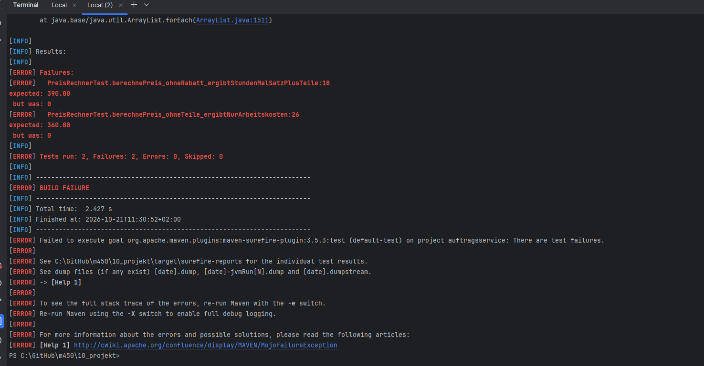 | 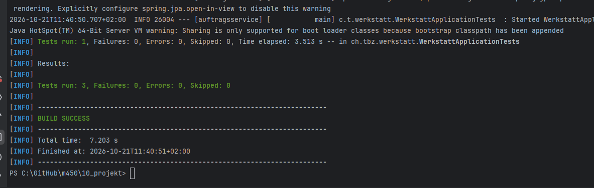 |

Im Red-Schritt gibt der `PreisRechner` noch fix `0` zurück, beide Tests schlagen fehl. Im Green-Schritt wurde nur so viel Code geschrieben, wie die Tests verlangen.

### Zyklus 2 – Mengenrabatt

| 🔴 Red | 🟢 Green |
|---|---|
| 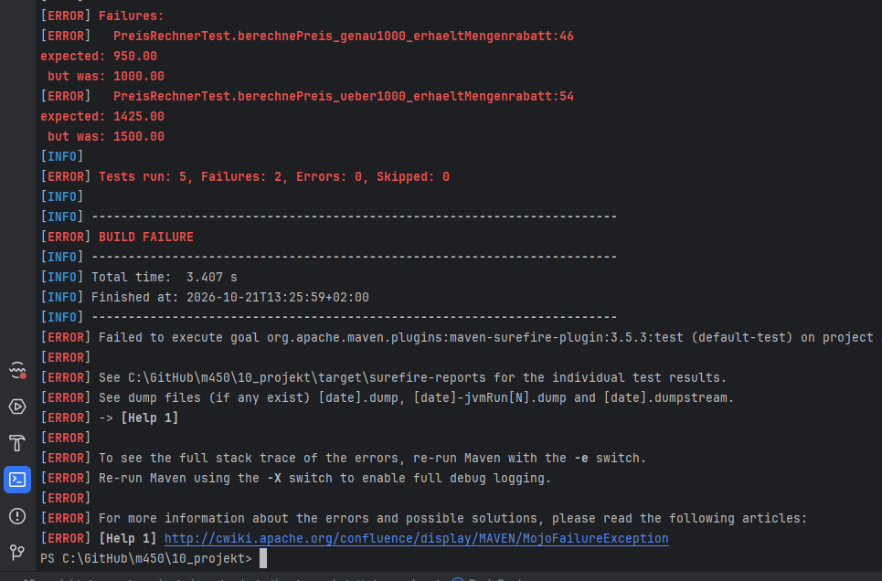 | 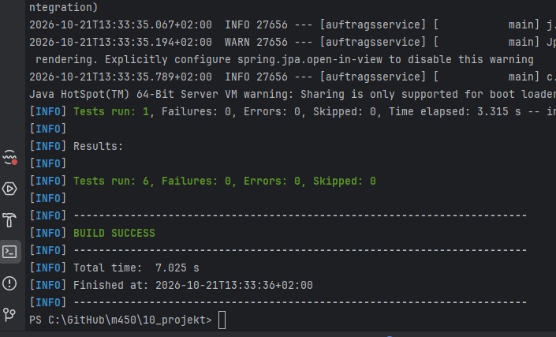 |

Nur zwei der drei neuen Tests schlagen fehl. Der Test «knapp unter 1000» ist von Anfang an grün und sichert ab, dass der Rabatt nicht zu früh greift.

### Zyklus 3 – Stammkundenrabatt und Refactoring

| 🔴 Red | 🟢 Green | 🔵 Refactor |
|---|---|---|
| 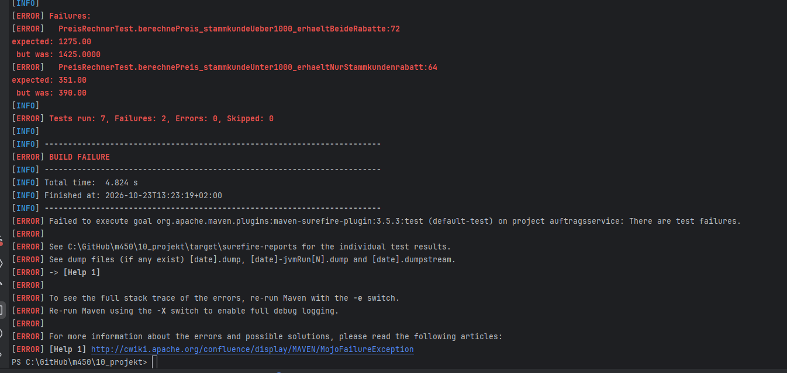 | 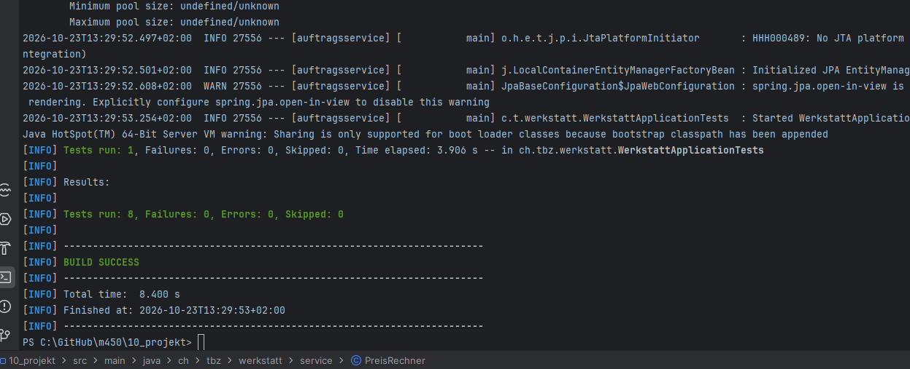 | 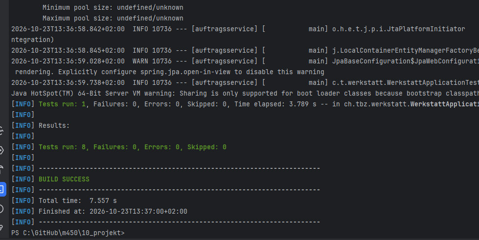 |

Im Red-Screenshot ist `1425.0000` mit vier Nachkommastellen sichtbar. Das hat den Refactor-Schritt ausgelöst: Rundung auf Rappen und Aufteilung in die Hilfsmethoden `berechneZwischensumme()` und `berechneRabattsatz()`. Dabei wurde **kein Test verändert**, und alle blieben grün.

### Zyklus 4 – Validierung

| 🔴 Red | 🟢 Green |
|---|---|
| 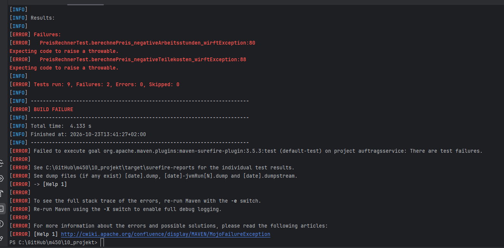 | 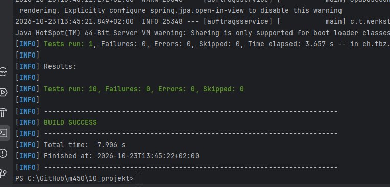 |

---

## 8. Mocking

### Unit Test: `AuftragService`

Das Repository und der externe Teilelieferant werden mit Mockito ersetzt. Spring wird nicht gestartet.

```java
@ExtendWith(MockitoExtension.class)
class AuftragServiceTest {

    @Mock
    private AuftragRepository auftragRepository;

    @Mock
    private TeileLieferantClient teileLieferantClient;
    ...
    when(teileLieferantClient.istTeilVerfuegbar("TURBO-001")).thenReturn(false);
    ...
    verify(auftragRepository, never()).save(any());
```

- `when(...).thenReturn(...)` steuert, ob ein Teil «verfügbar» ist.
- `verify(..., never())` prüft, dass bei einem nicht verfügbaren Teil nichts gespeichert wird.

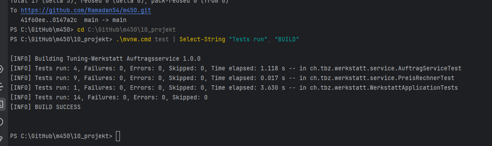

### Integration Test: `AuftragController`

Hier läuft die ganze Anwendung mit echter H2-Datenbank. Nur der externe Lieferant wird mit `@MockitoBean` im Spring-Kontext ersetzt.

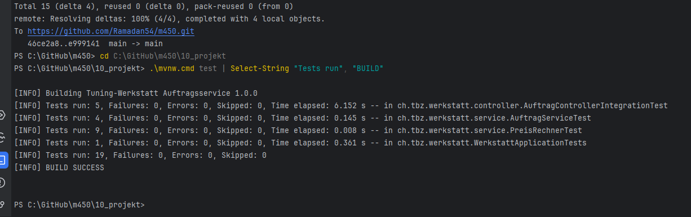

**Beobachtung:** Die Mockito-Unit-Tests laufen in ca. 0.15 s, die Integration Tests brauchen ca. 6–10 s. Das zeigt, warum man die Logik möglichst mit schnellen Unit Tests abdeckt.

---

## 9. Testreports und Code Coverage

### Surefire-Testreport

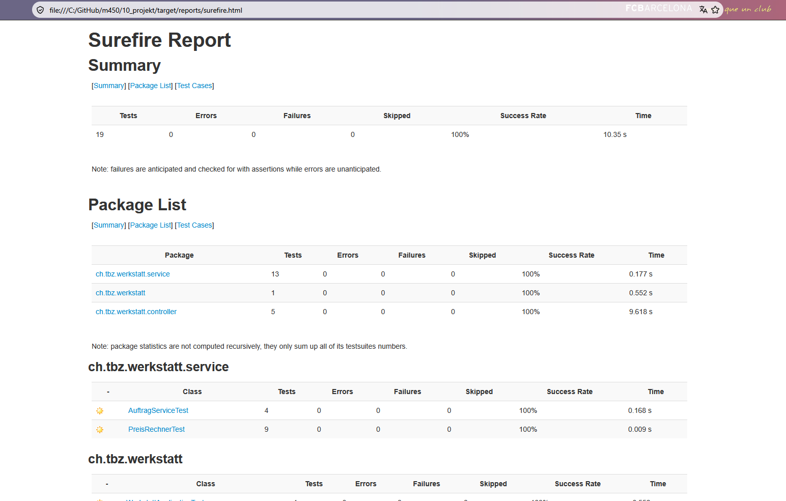

### JaCoCo Code Coverage – vorher / nachher

Der erste Coverage-Report hat eine echte Lücke aufgedeckt: Der `SimulierterTeileLieferantClient` wurde in allen Tests weggemockt und war deshalb selbst nie getestet (71 %). Mit einem parametrisierten Test wurde die Lücke geschlossen.

| Vorher | Nachher |
|---|---|
| 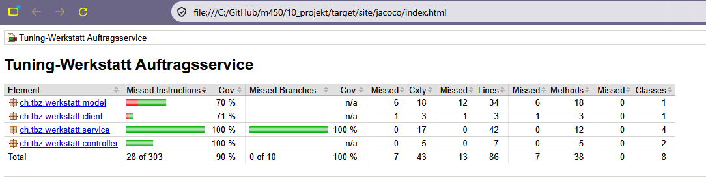 | 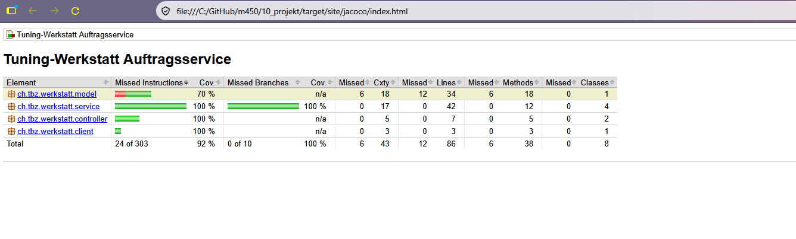 |

| Paket | Vorher | Nachher |
|---|---|---|
| `service` | 100 % | 100 % |
| `controller` | 100 % | 100 % |
| `client` | 71 % | **100 %** |
| `model` | 70 % | 70 % (nur Getter/Setter) |
| **Total Instructions** | 90 % | **92 %** |
| **Total Branches** | 100 % | **100 %** |

---

## 10. CI/CD-Pipeline

Datei: [`.github/workflows/projekt-ci.yml`](../.github/workflows/projekt-ci.yml)

Die Pipeline startet automatisch bei jedem Push auf `main`, der den Ordner `10_projekt` betrifft.

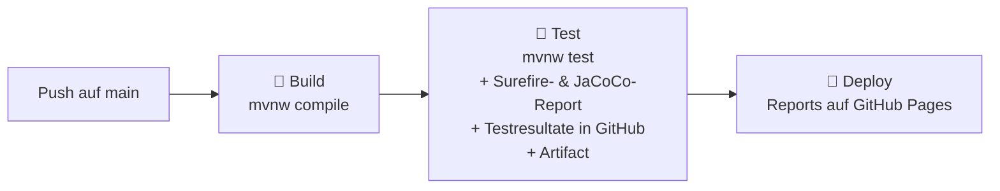

| Stage | Was passiert |
|---|---|
| **Build** | Code auschecken, JDK 17 installieren, Projekt kompilieren |
| **Test** | Tests ausführen, JaCoCo- und Surefire-Report erzeugen, Resultate als Test-Summary in GitHub anzeigen, Reports als Artifact `test-reports` hochladen |
| **Deploy** | Reports auf GitHub Pages veröffentlichen |

- Durch `needs` laufen die Stages nacheinander. **Schlägt ein Test fehl, wird nichts deployt.**
- Die Reports werden mit `if: always()` auch bei fehlgeschlagenen Tests erzeugt und als Artifact hochgeladen, damit man den Fehler analysieren kann.

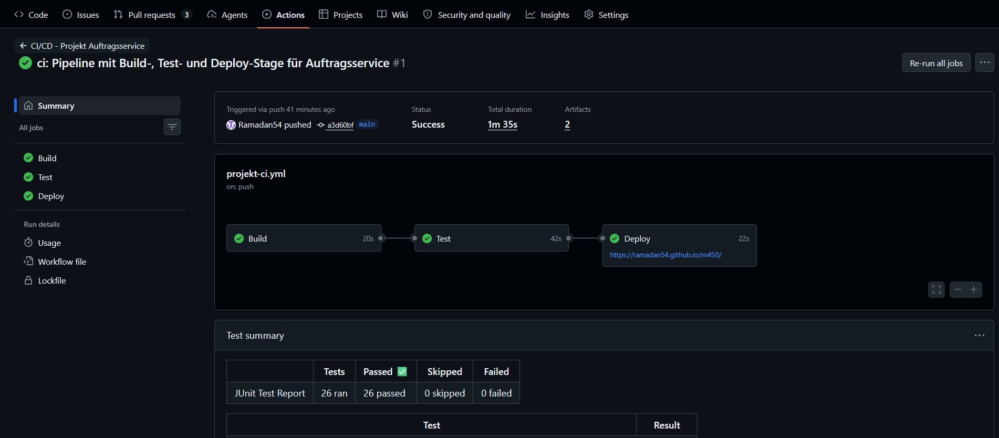

### Veröffentlichte Reports

| Startseite | Surefire | JaCoCo |
|---|---|---|
| 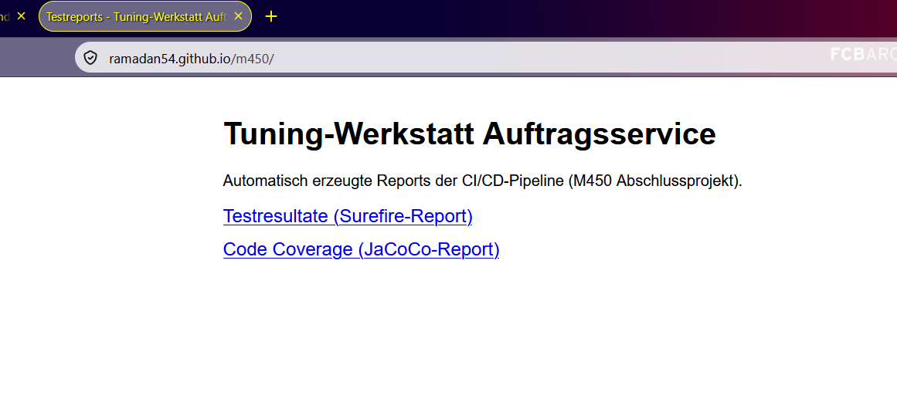 | 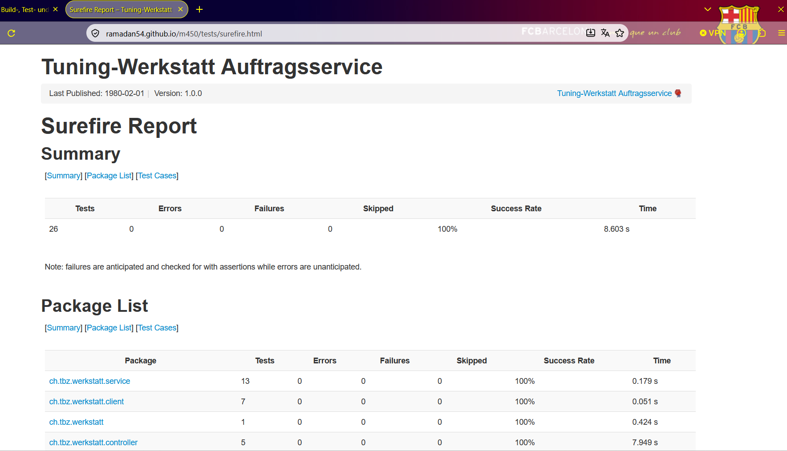 | 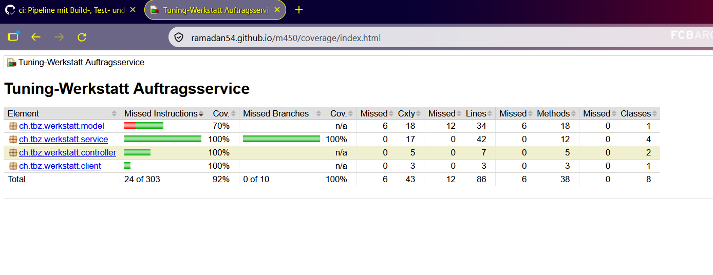 |

---

## 11. Projekt lokal ausführen

Voraussetzung: Java 17 (Maven muss nicht installiert sein, der Maven Wrapper lädt es automatisch).

```powershell
cd 10_projekt

# Alle Tests ausführen (erzeugt auch den JaCoCo-Report)
.\mvnw.cmd clean test

# Surefire-HTML-Report erzeugen
.\mvnw.cmd surefire-report:report-only

# Reports öffnen
start target\reports\surefire.html
start target\site\jacoco\index.html

# Anwendung starten (http://localhost:8080)
.\mvnw.cmd spring-boot:run
```

---

## 12. KI-Nutzung im Projekt

In diesem Projekt wurde KI (Claude von Anthropic) in folgenden Rollen eingesetzt:

| Rolle | Eingesetzt | Wofür |
|---|---|---|
| Als **Nachschlagewerk** für Detailfragen | ✅ | Klärung von Detailfragen zu Maven, JaCoCo, GitHub Actions und zur IntelliJ-Konfiguration |
| Zum **Schreiben von Code** (Autocomplete) | ❌ | Es wurde keine Autocomplete-Funktion eingesetzt. Ein Teil des Codes wurde eigenständig geschrieben. |
| Zum **automatischen Erstellen von Code** | 🟡 teilweise | Die KI lieferte bei einzelnen Teilen Codevorschläge, beispielsweise für Tests, die `pom.xml` und die Pipeline. Diese Vorschläge wurden geprüft, verstanden und bei Bedarf angepasst. Andere Teile wurden vollständig selbst umgesetzt. Die Umsetzung erfolgte somit als Kombination aus Eigenleistung und KI-Unterstützung. |
| Zum **Reviewen oder Optimieren** | ✅ | Die KI diente als begleitende Kontrollinstanz, vergleichbar mit einem erfahrenen Lernenden (Oberstift). Das eigene Vorgehen wurde regelmässig mit ihr abgeglichen, um sicherzustellen, dass der eingeschlagene Weg korrekt ist. Zudem wies sie auf Fehler hin, z.B. auf eine überflüssige Konfigurationsdatei, und unterstützte bei der Analyse der Coverage-Lücke. |

**Mein eigener Anteil:**

- Wahl des Themas Tuning-Werkstatt, das ich bereits in früheren Modulen verwendet habe, und Entscheid für genau dieses Projekt
- Scope-Entscheid: wenig Funktionalität, dafür vollständige Testabdeckung
- Jeden Schritt selbst ausgeführt: Dateien erstellt, Tests lokal laufen lassen, Ergebnisse geprüft, Fehler gemeldet und behoben (z.B. JAVA_HOME, IntelliJ-Maven-Import)
- Jeden Commit selbst erstellt und gepusht, nach jedem Teilschritt einzeln
- Dokumentation und Screenshots der Zwischenstände

---

## 13. Reflexion über TDD und Code Reviews

### TDD

Am Anfang fühlte es sich ungewohnt an, absichtlich einen Test zu schreiben, der fehlschlägt. Im Verlauf des Projekts habe ich aber den Nutzen deutlich gemerkt:

- **Klare Anforderungen:** Bevor ich Code geschrieben habe, musste ich mir überlegen, was genau das Ergebnis sein soll, z.B. ob «ab 1000 CHF» die 1000 selbst einschliesst. Der Grenzwert-Test hat diese Frage erzwungen.
- **Sicheres Refactoring:** Beim Umbau vom fixen Rabattfaktor (0.95) zu addierbaren Rabattsätzen und beim Aufteilen in Hilfsmethoden haben die bestehenden Tests sofort gezeigt, dass das Verhalten gleich geblieben ist.
- **Tests finden Verbesserungen:** Der fehlgeschlagene Test mit `1425.0000` hat gezeigt, dass die Rundung auf Rappen fehlte.
- **Kleine Schritte:** Weil jeder Zyklus nur eine Regel umfasst, war der Code jederzeit lauffähig und der Git-Verlauf sehr übersichtlich.

Grenzen sehe ich bei Teilen ohne Logik, z.B. Entity oder Konfiguration. Dort bringt TDD wenig, darum habe ich es gezielt nur für die Geschäftslogik eingesetzt. Im Berufsalltag würde ich TDD vor allem für Berechnungen und Regeln verwenden, wo Fehler teuer sind.

### Code Reviews

Da ich das Projekt alleine umgesetzt habe, gab es in Absprache mit der Lehrperson keine Pull Requests mit gegenseitigen Reviews. Aus Block 8 und diesem Projekt nehme ich trotzdem Folgendes mit:

- **Kleine Commits erleichtern Reviews:** Jeder Commit in diesem Projekt behandelt genau eine Sache. Ein Reviewer könnte so jeden Schritt einzeln nachvollziehen, statt eine riesige Änderung auf einmal prüfen zu müssen.
- **Automatische Prüfungen als Ergänzung:** Die Pipeline und der Coverage-Report haben die Rolle eines «automatischen Reviewers» übernommen. Der JaCoCo-Report hat z.B. die ungetestete Client-Klasse aufgedeckt, die mir selbst nicht aufgefallen war.
- **Was fehlt ohne Team:** Ein menschlicher Reviewer hätte zusätzlich Dinge wie Namensgebung, Lesbarkeit oder alternative Lösungsansätze hinterfragen können. Das kann kein Tool ersetzen.

Im Betrieb würde ich Pull Requests mit Review deshalb immer mit einer Pipeline kombinieren: Die Pipeline prüft, ob alles läuft, und der Mensch prüft, ob es verständlich und sinnvoll ist.

---

## 14. Fazit

Das Projekt führt alle Themen aus den Theorieblöcken in einem kleinen, aber vollständigen Beispiel zusammen: Unit Tests, Integration Tests, Mocking, TDD, Testreports, Code Coverage und eine CI/CD-Pipeline. Mit **26 Tests**, **100 % Coverage der Geschäftslogik** und einer Pipeline, die bei jedem Push automatisch testet und die Reports veröffentlicht, ist das Ziel des Projekts erreicht.

Die wichtigste Erkenntnis für mich: Gute Tests entstehen nicht zufällig, sondern durch eine klare Strategie. Wer vorher entscheidet, *was* mit *welcher* Testart geprüft wird und *was* gemockt wird, bekommt schnelle, zuverlässige Tests, auf die man sich beim Weiterentwickeln verlassen kann.